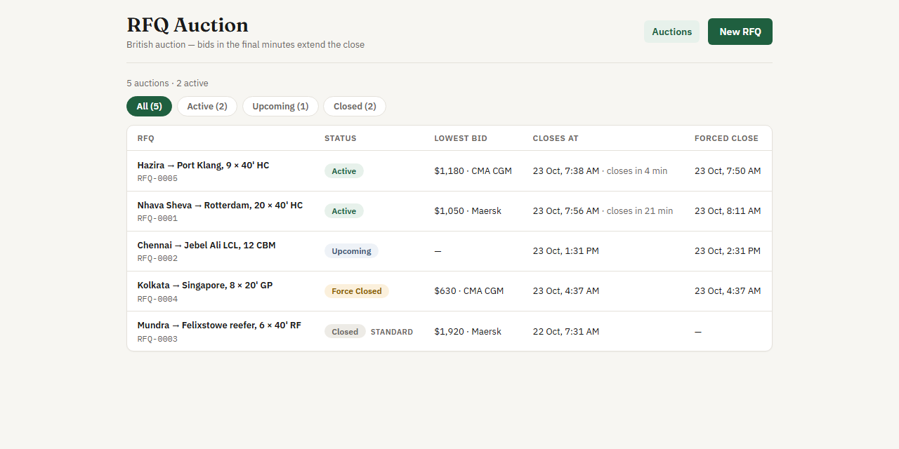
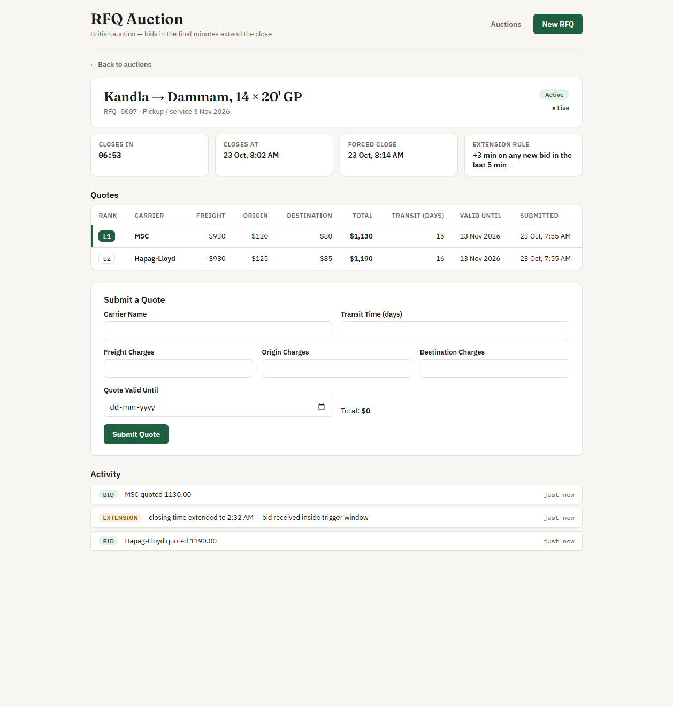

# RFQ Auction

Live: [frontend](https://british-auction-rfq-two.vercel.app) ·
[API](https://british-auction-api-yr4n.onrender.com) (interactive API docs at
[`/docs`](https://british-auction-api-yr4n.onrender.com/docs)). The backend runs on a free tier,
so the first request after it has been idle takes about a minute.

A reverse-auction platform for freight RFQs. A buyer publishes an RFQ with a bidding window,
carriers submit quotes against it, the lowest total holds the L1 rank, and bids arriving close
to the deadline extend the auction automatically — up to a hard forced-close ceiling.





## Design documents & deliverables

- **HLD + schema design**: [`hld and schema design/Hld and Schema design.pdf`](hld%20and%20schema%20design/Hld%20and%20Schema%20design.pdf) — architecture, flows and table design
- **Schema DDL**: [`docs/schema.sql`](docs/schema.sql) (the live source of truth is `backend/models.py`)
- **Backend code**: [`backend/`](backend/)
- **Frontend code**: [`frontend/`](frontend/)

## How the auction works

- **Status** is derived from timestamps on every read — there are no background jobs or timers.
  `Upcoming` before the start, `Active` until the current close, then `Closed` (or `Force Closed`
  if the close was extended all the way to the ceiling).
- **Ranking**: a carrier's current quote is its most recent one; current quotes sorted by total
  (freight + origin + destination, computed server-side) give L1, L2, L3…
- **Rebids** must be lower than the carrier's own previous total.
- **Extensions**: each RFQ configures a trigger window of X minutes, an extension of Y minutes and
  a trigger (`any_bid`, `any_rank_change` or `l1_change`). A qualifying bid inside the last
  X minutes moves the close forward by Y minutes, never past `forced_close_at`. Every bid and
  every extension (with its reason) lands in an activity log.
- **British auction is a per-RFQ option**: with it off, the RFQ is a standard one — no extension
  config, no forced close of its own, it simply closes at its bid close time.
- **Live updates**: the details page subscribes to a Server-Sent Events stream that pushes the
  full auction state every second, so rankings, the countdown and status flips appear without
  a refresh.

## Stack

- **Backend** — Python 3.12 (3.11+ works), FastAPI, SQLAlchemy 2, uvicorn. SQLite locally,
  Postgres in production via psycopg 3 (same code, switched by `DATABASE_URL`).
- **Frontend** — React 18 + Vite, react-router, native `fetch` + `EventSource`, one CSS file.

## Running locally

Backend (http://localhost:8000):

```bash
cd backend
python -m venv .venv
source .venv/bin/activate        # windows: .venv\Scripts\activate
pip install -r requirements.txt
cp .env.example .env
uvicorn main:app --reload --port 8000
```

On first start with an empty database the app seeds a few demo lanes by itself.

Frontend (http://localhost:5173):

```bash
cd frontend
npm install
cp .env.example .env
npm run dev
```

Tests (extension logic):

```bash
cd backend
pytest
```

## Environment variables

| Variable | Where | Default | Purpose |
|---|---|---|---|
| `DATABASE_URL` | backend | `sqlite:///./rfq.db` | SQLAlchemy connection string |
| `CORS_ORIGINS` | backend | `http://localhost:5173` | comma-separated allowed origins |
| `VITE_API_URL` | frontend | `http://localhost:8000` | base URL of the backend API |

## API

| Method | Path | Purpose |
|---|---|---|
| POST | `/rfqs` | create an RFQ (validates start < close < forced close) |
| GET | `/rfqs` | listing with status, lowest quote and close times |
| GET | `/rfqs/{id}` | details: config, ranked quotes, activity log |
| POST | `/rfqs/{id}/bids` | submit a quote; runs ranking and the extension check |
| GET | `/rfqs/{id}/stream` | SSE stream of the details payload, one event per second |

All timestamps are ISO-8601 UTC; the frontend formats them for display.

## Deploy

- **Backend** — defined by `render.yaml` (Render → New → Blueprint, pick this repo). Render
  prompts for `DATABASE_URL` (Postgres) and `CORS_ORIGINS` (the frontend URL).
- **Frontend (Vercel)** — root `frontend`, framework Vite, env `VITE_API_URL` = the API URL.
  `frontend/vercel.json` rewrites all routes to `index.html` so client-side routing works.
